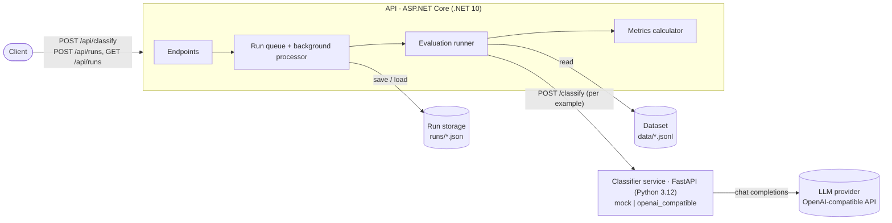

# AI Evaluation Lab

A platform for evaluating AI modules on labeled datasets, built with .NET and Python.

## Overview

LLM-based features are easy to demo but hard to measure: a prompt or model change can look better on a few examples and be worse overall. This platform runs an AI module over a labeled dataset, records every prediction, and computes standard classification metrics, so that configurations (models, prompts, providers) can be compared on the same data with the same scoring. The first module classifies Spanish customer support messages into four categories: `technical_support`, `billing`, `general_inquiry` and `account_management`. Evaluations run in the background through a REST API and are stored as JSON files that can be inspected, versioned and summarized.

## Architecture



Key decisions:

- **The module under test does not evaluate itself.** The Python service only classifies text. Datasets, runs and metrics live in the .NET API, so a change in the classifier cannot affect how it is scored. See [ADR 0001](docs/decisions/0001-separate-ai-service.md).
- **Every output is kept.** A model answer that is not a valid category is returned as `invalid` and counted as wrong; it is never dropped or fuzzy-matched.
- **Provider failures are not model errors.** A failed call (rate limit, timeout, authentication) is recorded as an `error` prediction and excluded from the metrics, and the run is marked `completed_with_errors`.
- **Reproducible runs.** Each run stores the classifier config, the dataset name and the SHA-256 of the dataset file, and every prediction with its raw output, tokens and latency.
- **No database in the MVP.** Runs are JSON files, and the run queue is in memory.

## Getting started

Requires Docker with Compose v2.

1. Create `.env` from the template and fill in the LLM provider settings. They are only needed for the `openai_compatible` provider; the `mock` provider works without them.

   ```bash
   cp .env.example .env
   # LLM_BASE_URL (e.g. https://api.groq.com/openai/v1), LLM_MODEL, LLM_API_KEY
   ```

2. Start both services:

   ```bash
   docker compose up --build -d
   ```

   The API listens on `http://localhost:8080`. The classifier service is only reachable from the API, inside the compose network. Datasets are read from `./data` and runs are written to `./runs`.

3. Classify a single message:

   ```bash
   curl -X POST http://localhost:8080/api/classify \
     -H "Content-Type: application/json" \
     -d '{"text": "Me cobraron dos veces este mes", "config": {"provider": "mock"}}'

   curl -X POST http://localhost:8080/api/classify \
     -H "Content-Type: application/json" \
     -d '{"text": "Me cobraron dos veces este mes", "config": {"provider": "openai_compatible", "prompt_version": "v1"}}'
   ```

   On Windows, send non-ASCII text from a UTF-8 file with `--data-binary @body.json`.

4. Run an evaluation and poll it until `status` is `completed`:

   ```bash
   curl -i -X POST http://localhost:8080/api/runs \
     -H "Content-Type: application/json" \
     -d '{"dataset": "support-messages-v0", "split": "test", "config": {"provider": "openai_compatible", "prompt_version": "v1", "model": "openai/gpt-oss-120b"}}'

   curl http://localhost:8080/api/runs/<run_id>   # full run: predictions and metrics
   curl http://localhost:8080/api/runs            # summaries, newest first
   ```

5. Summarize stored runs as markdown:

   ```bash
   uv run scripts/summarize_runs.py
   ```

Stop everything with `docker compose down`. To run the services without Docker, see [src/api/README.md](src/api/README.md) and [src/classifier-service/README.md](src/classifier-service/README.md).

## Evaluation methodology

**Dataset.** [`data/support-messages-v0.jsonl`](data/README.md) contains 40 synthetic customer support messages in Rioplatense Spanish, 10 per category. They are split into `dev` and `test` with 5 messages per category in each, stratified by category. Each message is marked `clear` (29) or `ambiguous` (11). Both splits contain ambiguous messages: 6 in `dev` and 5 in `test`.

**Labeling guidelines.** Labels follow [docs/labeling-guidelines.md](docs/labeling-guidelines.md). The guidelines define each category and include seven boundary rules for messages that could fit more than one, all based on the primary action the support team must take. An `ambiguous` message must be resolvable by a named rule.

**Metrics.** The .NET API computes accuracy, per-class precision, recall and F1, macro and weighted averages, and a confusion matrix. Labels with no support count as 0 in the macro average. The implementation is tested against reference values generated with scikit-learn ([scripts/generate_metrics_fixtures.py](scripts/README.md)) with a tolerance of 1e-9.

**Invalid vs. error.**

| Prediction status | Meaning | In metrics |
| --- | --- | --- |
| `ok` | The classifier returned one of the four categories. | Yes |
| `invalid` | The classifier answered, but not with a valid category (another label, malformed JSON, empty output). | Yes, as a wrong prediction (extra `invalid` column in the confusion matrix) |
| `error` | The call failed (rate limit, timeout, provider error). | No; reported as `error_count` |

**Prompt selection.** Prompts are versioned files. `v1` contains the category definitions, and `v2` adds the boundary rules. Prompts are compared on `dev`, and the chosen configuration is reported on `test`. The `test` split is not used to choose between configurations. The guidelines' example messages are not included in the prompts, because some of them are close to dataset messages.

## Results

Runs from `openai/gpt-oss-120b` on Groq, temperature 0.0, one run per configuration, run one example at a time (`Evaluation:MaxParallelism` = 1). The mock classifier is a keyword baseline. Run files are in [docs/results/](docs/results/). This table was generated with `uv run scripts/summarize_runs.py`:

| Config | Split | Accuracy | Macro F1 | Invalid | Errors | Total tokens | Mean end-to-end latency (ms) | Accuracy (clear) | Accuracy (ambiguous) |
| --- | --- | --- | --- | --- | --- | --- | --- | --- | --- |
| gpt-oss-120b, prompt v1 | dev | 1.000 | 1.000 | 0 | 0 | 14,119 | 776 | 1.000 (14/14) | 1.000 (6/6) |
| gpt-oss-120b, prompt v2 | dev | 1.000 | 1.000 | 0 | 0 | 22,926 | 4238 | 1.000 (14/14) | 1.000 (6/6) |
| gpt-oss-120b, prompt v1 | test | 0.950 | 0.949 | 0 | 0 | 13,700 | 1805 | 1.000 (15/15) | 0.800 (4/5) |
| gpt-oss-120b, prompt v2 | test | 0.950 | 0.949 | 0 | 0 | 22,764 | 3564 | 1.000 (15/15) | 0.800 (4/5) |
| mock | test | 0.250 | 0.213 | 0 | 0 | – | 9 | 0.333 (5/15) | 0.000 (0/5) |

On `dev`, prompts `v1` and `v2` both reached an accuracy of 1.000, so `dev` did not separate them. `v1` is the selected configuration because it used fewer tokens: 14,119 vs. 22,926 on `dev`.

**Selected configuration on `test`** (`gpt-oss-120b`, prompt `v1`, [run file](docs/results/test-v1-gpt-oss-120b.json)). The `v2` run on `test` has identical per-class metrics and the same confusion matrix.

| Class | Precision | Recall | F1 | Support |
| --- | --- | --- | --- | --- |
| technical_support | 1.000 | 1.000 | 1.000 | 5 |
| billing | 0.833 | 1.000 | 0.909 | 5 |
| general_inquiry | 1.000 | 0.800 | 0.889 | 5 |
| account_management | 1.000 | 1.000 | 1.000 | 5 |

| Expected \ Predicted | technical_support | billing | general_inquiry | account_management | invalid |
| --- | --- | --- | --- | --- | --- |
| technical_support | 5 | 0 | 0 | 0 | 0 |
| billing | 0 | 5 | 0 | 0 | 0 |
| general_inquiry | 0 | 1 | 4 | 0 | 0 |
| account_management | 0 | 0 | 0 | 5 | 0 |

Misclassified `test` examples:

| Id | Difficulty | Expected | Predicted |
| --- | --- | --- | --- |
| msg-039 | ambiguous | general_inquiry | billing |

<!-- error analysis -->

## Limitations

- **Small test set.** The `test` split has 20 messages, so a single error moves accuracy by 5 points. Differences of one or two examples between configurations are not meaningful.
- **No variance estimate.** Each configuration was run once. Repeated runs would be needed to know how stable the results are, even at temperature 0.0.
- **Synthetic data.** The messages were written for this project, and the clear messages deliberately avoid obvious keywords. Results may not transfer to real support traffic, and the mock baseline is not representative of a keyword classifier on real messages.
- **Latency includes provider retries.** `latency_ms` measures the SDK call, including automatic retries after rate limits, so latency comparisons between runs are not reliable.
- **In-memory run queue.** Runs that are queued or running when the API stops are not resumed after a restart.
- **Rate limits surface as 502 in `/api/classify`.** The classifier service returns 503 for provider rate limits, but the .NET client maps every non-422 classifier error to 502. Evaluation runs are not affected, because both cases are recorded as `error` predictions.

## Roadmap

- **Prompt comparison:** more prompt versions, evaluated on a larger `dev` split.
- **Model comparison:** for example `gpt-oss-20b` vs. `gpt-oss-120b`, comparing quality, tokens and latency.
- **Dashboard:** a UI to browse runs, compare configurations and inspect misclassified examples.
- **Persistence:** a database for runs and a durable queue, so that runs survive restarts.
- **New modules:** other AI tasks evaluated with the same dataset, run and metrics pipeline.
